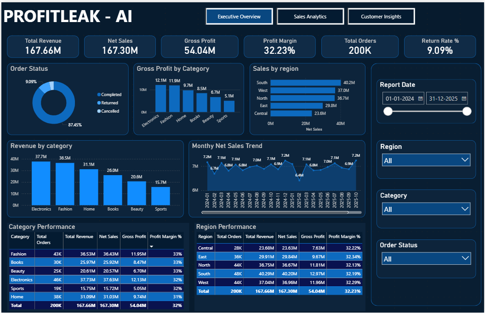
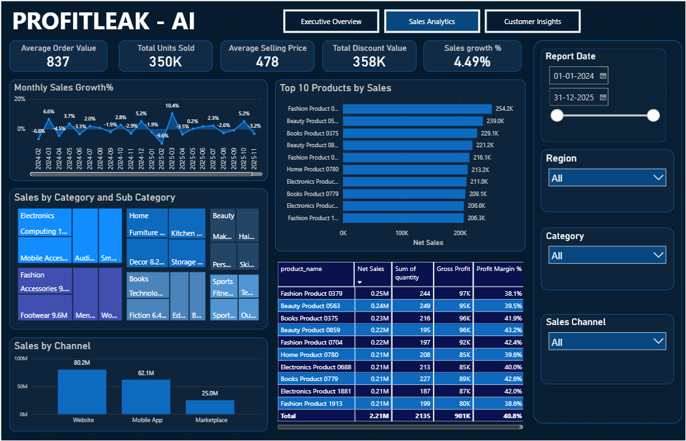
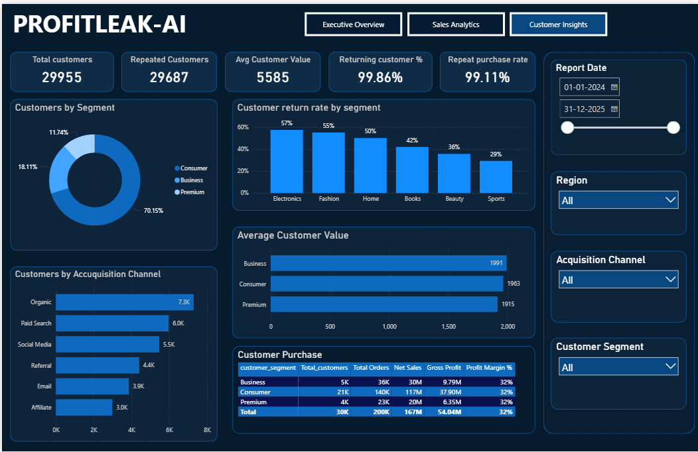

# PROFITLEAK - AI

An interactive Power BI dashboard for analyzing sales performance, profitability, and customer behavior.

## Dashboard Preview

### Executive Overview

### Sales Analytics

### Customer Insights

## Features
- Executive KPIs for revenue, profit, margins, and returns
- Sales trends, product performance, and channel analysis
- Customer segmentation, acquisition, and repeat-purchase analysis
- Interactive filters for dates, regions, categories, and customer segments

## Tech Stack
- Microsoft Power BI
- Python
- SQL
- PostgreSQL

## Repository Structure
- `powerbi/` — Power BI dashboard
- `python/` — data preparation and analysis scripts
- `sql/` — SQL analysis scripts
- `Screenshots/` — dashboard previews

## Author
**Jivika V S**  
B.Tech in Artificial Intelligence and Data Science
